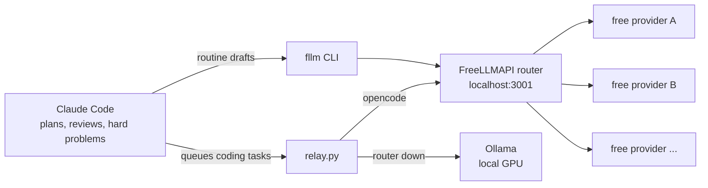

# zero-cost-ai-stack

How I run a lot of AI-assisted work on one paid plan: Claude Code does the thinking, and everything routine goes to free LLM APIs and models on my own GPU.

I build 3D printing tools, CAD generators and small apps on the side of a full-time job. Most of that work is drafting, boilerplate, summaries and overnight coding tasks that don't need a top model. This repo is the plumbing that sends that work somewhere free, keeps a log of who did what, and refuses to leak anything private on the way.

## Contents

- [How it fits together](#how-it-fits-together)
- [What's in here](#whats-in-here)
  - [fllm: one command, four tiers](#fllm-one-command-four-tiers)
  - [relay: an overnight task runner](#relay-an-overnight-task-runner)
  - [Budget awareness](#budget-awareness)
  - [Adding provider keys safely](#adding-provider-keys-safely)
  - [Launch videos for any repo](#launch-videos-for-any-repo)
- [The rules I follow](#the-rules-i-follow)
- [Quick start](#quick-start)
- [Safety](#safety)
- [Credits and licence](#credits-and-licence)

## How it fits together



Claude stays the orchestrator. It decides what to hand off, sends it out, and checks what comes back before anything lands in a repo.

## What's in here

| Path | What it does |
|---|---|
| `bin/fllm` | Send a task to the router with a pinned model tier |
| `bin/fllm-stats` | Usage per model from fllm's log |
| `relay/relay.py` | Unattended task queue: opencode on free models, local fallback, verify gate |
| `relay/claude_statusline.py` | Claude Code status line with 5 hour and weekly usage |
| `relay/codex_usage.py` | Reads the Codex usage window |
| `relay/router_add_keys.py` | Adds provider keys to the router, testing each one first |
| `relay/launch_video.sh` | Launch video for any repo, rendered locally |
| `opencode/opencode.example.json` | Points opencode at the router |

### fllm: one command, four tiers

```bash
fllm -t fast "rewrite this commit message: ..."
fllm -t code -f parser.py -o test_parser.py "write pytest tests for this"
cat build.log | fllm -t long "what failed and why"
```

Each tier (`fast`, `code`, `smart`, `long`) is a fixed chain of free models. The first one that answers wins, and the rest are fallbacks. I pin the chains on purpose: the router's `auto` mode tends to land on small models that give weak answers.

Before anything goes out, fllm checks the input for things that look like API keys, tokens or private keys and refuses to send them. Every call is logged to a TSV, and `fllm-stats` shows which models are doing the work.

### relay: an overnight task runner

A task is a markdown file in `queue/`:

```
repo: /path/to/project
verify: pytest tests/test_export.py -q
size: small
timeout: 1800

Add a --dry-run flag to export.py that prints the files it would write.
```

`relay.py run` picks tasks up one by one and runs opencode on router models. When the router is down it falls back to local Ollama models. A task only counts as done when its `verify` command exits 0. If it keeps failing, the task moves to `stuck/` for me to look at. Separate lanes let two queues run at once on different repos. Relay never calls Claude.

### Budget awareness

`claude_statusline.py` is a Claude Code status line that shows the 5 hour and weekly usage. It also saves that data to a file, so relay and my own scripts know how much of the plan is left before starting something heavy.

### Adding provider keys safely

`router_add_keys.py` walks through providers one at a time. It opens the key page in the browser, you paste the key into a hidden prompt, it tests the key against the provider directly, and only a working key goes into the router. The key is never printed or written anywhere else.

### Launch videos for any repo

```bash
relay/launch_video.sh ~/code/my-project --tone polished
```

This runs the open source [Brag](https://github.com/latent-spaces/brag) skill through opencode on free models. HyperFrames renders the video locally with headless Chrome and ffmpeg, and Kokoro does the voice-over on the local machine. If one model fails, it tries the next.

## The rules I follow

Free models are useful, but they are third-party services and they make mistakes. So every hand-off goes through four checks:

1. **Route.** Delegate summaries, first drafts, docs, boilerplate and test scaffolds. Keep architecture, hard debugging, geometry maths, security-sensitive code and anything that gets posted publicly with Claude.
2. **Data.** Never send secrets, credentials, `.env` files, or employer or customer data to a free provider.
3. **Verify.** Delegated output goes to a file first. Code has to pass its tests, and prose gets read for facts and tone before it lands anywhere.
4. **Report.** Say which model did the work. fllm prints it on every call.

The full version is in [docs/DELEGATION_RULES.md](docs/DELEGATION_RULES.md).

## Quick start

1. Run the router: clone [FreeLLMAPI](https://github.com/tashfeenahmed/freellmapi), add your free provider keys, then `docker compose up -d`.
2. Save the router key: put it in `~/.config/freellmapi-key` and `chmod 600` it.
3. Install the CLI: `cp bin/* ~/.local/bin/` (needs `curl` and `jq`).
4. Try it: `fllm -t fast "say hello in five words"`.
5. Optional: copy the provider block from `opencode/opencode.example.json` into your opencode config, then run `python3 relay/relay.py once`. Relay keeps its queue in `~/relay` (set `RELAY_HOME` to change it).

Model names in the tier chains change as providers update. Run `fllm-stats` after a few calls and swap out any that keep failing.

## Safety

- No keys live in this repo. Everything reads the key from a file at runtime.
- fllm refuses input that matches common secret patterns. That's a safety net, not a guarantee, so the data rule above still applies.
- Free providers can log what you send. Treat them like a public forum.

## Credits and licence

- [FreeLLMAPI](https://github.com/tashfeenahmed/freellmapi) by Tashfeen Ahmed (MIT) does the routing.
- [Brag](https://github.com/latent-spaces/brag) (MIT), [HyperFrames](https://github.com/heygen-com/hyperframes) (MIT), [opencode](https://opencode.ai), [Ollama](https://ollama.com) and Kokoro TTS.

My code here is MIT. See [LICENSE](LICENSE).
